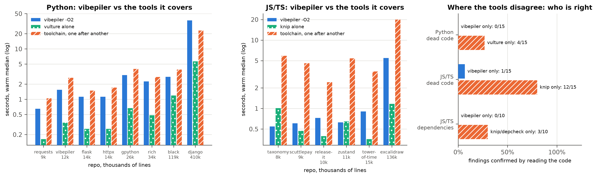

# Evaluation: vibepiler against the standard tools

vibepiler 0.4.5 (`d9ca2bb`) compared, check by check, with the tools people already use for each job, on pinned open-source repos. Every repo is pinned to a SHA. The harnesses live in `scripts/eval/` and rerun from the repo root with one command each; clones, tools and raw outputs go to `.eval/` (gitignored), or to `$VIBEPILER_EVAL_WORK`.

*Left and middle: warm median wall time on a log scale. Blue is vibepiler -O2. Green is the dead-code tool alone (vulture for Python, knip for JS/TS). Orange is every tool that covers the same checks, run one after another. Right: findings only one side reported, sampled and checked by reading the code at the pinned SHA. Regenerate with `uv run scripts/eval_figure.py`.*

| | Python | JS/TS |
|---|---|---|
| report | [python/RESULTS.md](python/RESULTS.md) | [javascript/RESULTS.md](javascript/RESULTS.md) |
| repos | requests, flask, httpx, vibepiler, gpython, rich, black, django (9k–410k lines) | zustand, release-it, taxonomy, excalidraw, and two vibe-coded apps, scuttlepay and tower-of-time (8k–136k lines) |
| compared with | vulture, deadcode, ruff, deptry, pylint, jscpd, radon, complexipy | knip, ts-prune, ts-unused-exports, depcheck, jscpd, madge, ESLint + sonarjs |
| harness | [scripts/eval/python/](../../scripts/eval/python/): `sh scripts/eval/python/run_all.sh` | [scripts/eval/javascript/](../../scripts/eval/javascript/): `sh scripts/eval/javascript/run.sh` |

Machine: Apple M3 Max, 14 cores, 36 GB, CPU only. The JS/TS timings ran while other benchmarks were using the same machine, so read them as approximate.

## What holds up

- **Determinism.** Identical diagnostics on every repeated run: 64 Python runs and 48 JS/TS runs.
- **Speed against the toolchain.** On repos up to about 120k lines, vibepiler -O2 is faster than running the tools it covers one after another: 0.6–0.8× their time for Python and 3–11× faster for JS/TS. Any single tool is faster at its one job; vulture is 4–6× faster, and ruff 20–300×.
- **Metrics.** Cyclomatic complexity matches radon on 99.9% of 31.5k Python functions, and cognitive complexity matches complexipy on 94%. Against ESLint and sonarjs, 60–87% are exact matches.
- **Cycles and swallowed exceptions.** Import cycles match madge's graph (Jaccard 0.96–1.00). Broad `except: pass` matches ruff S110 exactly on two of three repos.
- **Dead stores.** All 6 sampled dead stores that ruff does not look for (a value overwritten before it is read) were real.

## What does not, yet

- **Dead code where the tools disagree.** All 15 Python findings only vibepiler reported were wrong, and 14 of 15 JS/TS ones were. vulture was right on 4 of 15 of its own disagreements, and knip on 12 of 15. Most of vibepiler's misses are linker gaps: stdlib imports resolved to same-named project modules, exceptions used only in an `except` clause, re-exports through `export *` or chained `import *`, tsconfig path aliases, workspace packages, package.json `bin` entries. Both reports list each bug with file:line evidence; the Python ones also have a minimal reproduction in [scripts/eval/python/repro/](../../scripts/eval/python/repro/).
- *Rerun at 0.4.8* ([python/RESULTS.md](python/RESULTS.md#rerun-at-048-2026-11-09)): vibepiler-only dead definitions fell from 985 to 458, and the call-site link rate rose from 46–68% to 50–84% with the typed linker. On a fresh hand-checked sample of the disagreements, vibepiler is right on 2 of 15 and vulture on 5 of 13 decided: vulture is still ahead where they disagree. The 13 wrong ones are new gaps (O–V: public-API class methods, framework-hook callees, unittest classes outside `test_*` files, Django backend `.base` modules, dotted function strings, asv benchmarks, registering decorators on nested defs, scripts inside `try/else`), none from the typed linker.
- *Before that:* the Python bugs A to N are fixed (see the note under the bug table in [python/RESULTS.md](python/RESULTS.md)); with four rules for dynamic loading (scripts, `getattr` prefix dispatch, modules named in strings, Django's framework folders) and escape analysis for objects handed to library code, all 15 Python false positives are gone. The JS/TS gaps are not fixed yet.
- **Large repos.** On django (410k lines), vibepiler takes 36.7 s with a 2.6 GB peak, where the toolchain takes 23.2 s. The time goes to parsing in one process, two walks over every function body (complexity, liveness) and a 129 MB `ir.json`.
- **Kinds no compared tool reports** (wrappers, single-implementation interfaces, class-as-function, single-use helpers, test-only code; about 1,800 in Python and 770 in JS/TS) have not been hand-checked yet.

## Safety note

The corpus code was never installed or run. One exception: knip loads each JS/TS repo's config files (`next.config.js`, vite and drizzle configs), which executes them. That was caught after a few runs; from then on knip and depcheck ran in a macOS sandbox with the network denied (`scripts/eval/javascript/nonet.sb`), and every reported number comes from those runs.

## Semantic tier (`-O3`)

Full report: [semantic/RESULTS.md](semantic/RESULTS.md); harness: `bash scripts/eval/semantic/run_all.sh` (about 1.5 h; datasets and models go to `.eval/semantic/`, never `~/.cache`). Labelled data: CodeNet Python800 (2,000 programs, 100 problems) and the Python type-4 split of GPTCloneBench (6,843 functions).

- **Quality.** CodeRankEmbed int8 reaches MAP@R 0.559 on CodeNet (P@1 0.887), tied with fp32 (0.580) and jina int8 (0.574) within their confidence intervals, and about 2.3× the static and general-text models.
- **The mutual-nearest-neighbour rule.** At the same 0.72 threshold it raises precision 7.5× over a plain threshold (0.055 → 0.41) and cuts the list 10× (1,627 → 156 pairs), and its F1 (0.36) beats the best plain threshold picked with hindsight (0.25). 0.72 is well calibrated for CodeRankEmbed; the defaults for jina, potion and bge are not.
- **int8 against fp32.** MAP@R −0.022 (CodeNet) and −0.004 (GCB), the same pair-detection F1, top-10 overlap 0.88–0.91. int8 is about 1.4× faster (the main README said 2× before this evaluation), needs half the memory (3.0 GB vs 6.2 GB on django), loads in 0.5 s instead of 5 s, and installs in 166 MB instead of 912 MB with PyTorch.
- **Structural tools cannot see these.** On 19,000 same-problem pairs, vibepiler's own near-duplicate rule finds 0.35%, an exact shape hash 0.18% and jscpd at most 0.31%. CodeRankEmbed at 0.72 finds 42%.
- **Embedding cache.** A second `-O3` run is 4.6–5.2× faster (django: 264 s → 51 s).
- **In real repos, precision is about 0.53–0.60** (8 right, 6 wrong, 1 unclear in the top 15 across vibepiler, rich and django). Most wrong pairs are a function and the function it calls or wraps (31 of 177 reported pairs), which a call-edge filter would remove. Two bugs: closures inside methods are embedded although the README says closures are skipped, and the 100-pair cap truncates django's list silently.
